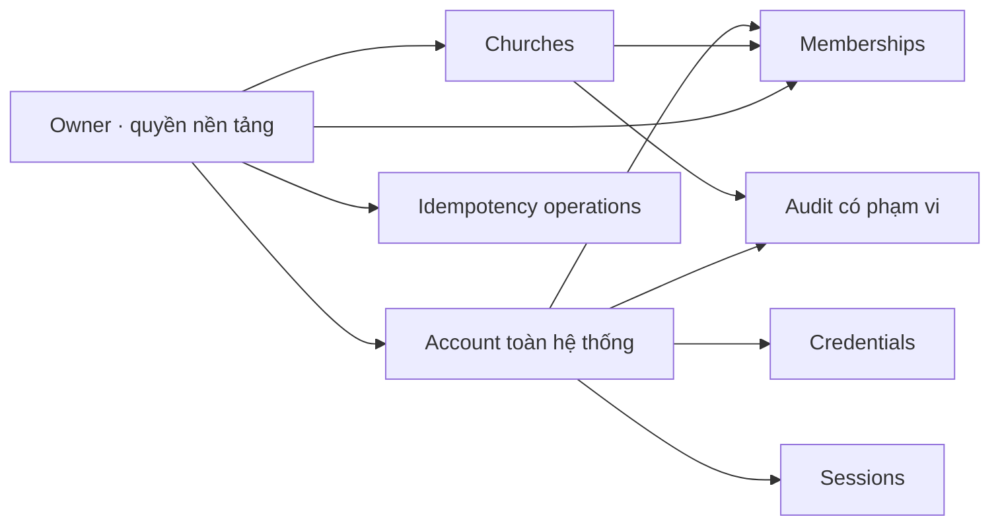

# P0 nền tảng — Mô hình dữ liệu, API và nghiệm thu

Revision: `P0-FOUNDATION-r1` · 2026-11-10 · Task cha: `CHURCH-P0`.

**ĐỀ XUẤT KỸ THUẬT CHỜ DUYỆT.** Khiêm cho phép hoàn thiện thiết kế và cập nhật hồ sơ, chưa implement ứng dụng. C16 chấp thuận phần P0 đã trình trước đó; không tự chuyển thành phê duyệt các contracts mới trong r1 này.

Nguồn sản phẩm và lịch sử: [CHURCH-P0](../tasks/CHURCH-P0.md). Trạng thái sống: [project-state](../project-state.md). Không có code ứng dụng, schema/driver hiện hữu hoặc database kết nối để reverse-engineer; đây là thiết kế mới trên stack đã chọn, không phải schema quan sát từ runtime.

## 1. Phạm vi, nguồn và quyết định

Phạm vi: một gói thiết kế nền tảng xuyên dữ liệu → API → callers A01/A02/A04/O01/O02/O03 → tiêu chí kiểm chứng. Không thêm UI mới, invitation, đăng ký tự do, khôi phục tự phục vụ, 2FA, billing hoặc module nghiệp vụ P2–P7. Chưa viết OpenAPI thực thi, migration, scaffold hoặc tests ứng dụng.

| Mã | Quyết định kỹ thuật đề xuất | Lý do / phương án không chọn |
|---|---|---|
| FD01 | Modular monolith; route → application service → repository; MongoDB collections chung có tenant scope | Giữ stack; không microservices hoặc collection riêng mỗi Hội Thánh. Nếu cần cách ly vật lý phải có thiết kế khác |
| FD02 | Account toàn hệ thống; membership theo Hội Thánh; credentials tách collection | Thêm tenant không đổi mật khẩu; DTO/list không vô tình trả credential |
| FD03 | MongoDB là nguồn có thẩm quyền cho session/revocation và thao tác quản trị; Redis cho rate-limit | Không dùng JWT chứa quyền lâu dài hoặc Redis cache làm nguồn quyết định quyền |
| FD04 | Cookie opaque, cùng origin frontend/API; CSRF token và kiểm tra Origin | Không lưu bearer/session token trong localStorage; không CORS wildcard có credentials |
| FD05 | Mỗi request chỉ rõ churchId trên path; không có selectedChurch toàn cục phía session | Hai tab có thể làm việc hai Hội Thánh; URL/context không thay thế authorization |
| FD06 | CAS/version, unique indexes, transaction và idempotency ledger | Không check-then-insert hoặc dựa Redis lock để bảo toàn dữ liệu |
| FD07 | Mật khẩu tạm chỉ lộ trong response đầu; retry không trả lại secret | Không lưu plaintext để replay. Mất response thì đối soát operation rồi owner chủ động cấp lại |

MongoDB hỗ trợ transaction nhiều document; thiết kế này yêu cầu môi trường replica set cho local integration/staging/production, không standalone. Transaction có chi phí, chỉ dùng cho thay đổi cần nhất quán. [MongoDB transactions](https://www.mongodb.com/docs/manual/core/transactions/)

Các đề xuất thông số mới (rate-limit, hash cost, page size, CSRF/bootstrap, TTL của phiên giới hạn) là một phần r1 chờ duyệt; không là thông số đã có trong prototype.

## 2. Sở hữu và mô hình quan hệ



Đây là sơ đồ thiết kế, chưa là bằng chứng database hoạt động. `churchId` là tenantId trong collection nền tảng; không lưu đồng thời hai trường cùng nghĩa. Collection nghiệp vụ tương lai phải dùng cùng định danh Church và tên scope nhất quán qua contracts.

| Thành phần | Sở hữu dữ liệu | Public contract nội bộ |
|---|---|---|
| Identity | accounts, credentials, sessions | authenticate, requireFullSession, checkAccount, rotateCredentials; không trả hash |
| Tenancy | churches, memberships | resolveChurchAccess, grant/updateMembership, checkActiveChurch |
| Authorization | Danh mục capability/role versioned trong source | capabilities(actor, church, membership); owner và church role tách biệt |
| Owner administration | Điều phối create/provision/reset/status | Gọi Identity/Tenancy trong transaction, không gọi HTTP nội bộ |
| Audit/operations | audit_events, idempotency_operations | Ghi cùng transaction, safe projection và replay |

Public modules không nhận Mongo collection handle từ module khác. Repository có transaction context được truyền tường minh. Identity account khác thuộc viên P2; không tự ghép bằng email/tên. `subjectMemberId` chỉ được dùng khi module thuộc viên kiểm chứng liên kết cùng churchId.

## 3. Quy ước dữ liệu

- `_id`: ObjectId; API trả chuỗi 24 ký tự hex thường và kiểm tra định dạng trước query. Business code không làm khóa ngoại.
- `createdAt`, `updatedAt`, hạn dùng: BSON Date UTC; API ISO 8601 UTC. Ngày nghiệp vụ ở P2–P7 không tự dùng Timestamp thay ngày.
- `version`: integer tăng khi thay đổi nội dung/status; ETag là version của resource. `writeFence` là counter nội bộ riêng, không làm đổi ETag chỉ vì kiểm tra quyền.
- `email`: giá trị hiển thị; `emailKey`: trim đầu/cuối + lowercase toàn bộ theo chính sách account không phân biệt hoa/thường. Không bỏ dấu chấm, dấu cộng, hoặc tự đồng nhất alias của nhà cung cấp. P1 nhận địa chỉ email ASCII hợp lệ dài tối đa 254; email quốc tế cần mở rộng có chủ đích sau.
- nameKey/displayNameKey là bản lowercase của tên đã trim, không bỏ dấu; không dùng làm ID/unique. Tên: trim khoảng trắng ngoài, 1–160 Unicode code points; điện thoại là chuỗi tối đa 32 ký tự, giữ dấu +/số 0 đầu. Text địa chỉ tối đa 500. Không nhận HTML.
- Email hiện có không bị đổi tên/account/profile bởi form cấp membership. Không cho sửa email trong r1.
- JSON schema tại persistence dùng allowlist field/enum/type; field lạ hoặc chứa cấu trúc operator như `$ne` ở giá trị chuỗi bị từ chối. Trường nội bộ không được mass-assign từ request.
- Không xóa account/church/membership qua HTTP trong scope này; dùng status. Không có cascade delete.

### 3.1 Collections

| Collection | Trường chính | Invariants / dữ liệu không trả client |
|---|---|---|
| `churches` | `_id`, `code`, `name`, `nameKey`, `district?`, `province`, `address?`, `contact{name?,phone?,email?}`, `status:active/suspended`, `version`, `writeFence`, timestamps/actor IDs | code bất biến, duy nhất, tự cấp; name không unique; suspend không xóa dữ liệu |
| `accounts` | `_id`, `email`, `emailKey`, `displayName`, `displayNameKey`, `status:active/locked`, `platformRole:owner/none`, `authEpoch`, `version`, `writeFence`, timestamps | authEpoch tăng khi reset/lock/unlock/password change để phiên cũ không sống lại. Owner role không nhận từ API cấp account |
| `credentials` | `_id`, `accountId`, `passwordHash`, `kind:temporary/permanent`, `temporaryExpiresAt?`, `credentialVersion`, `updatedAt`, `writeFence` | unique accountId; temp bắt buộc có hạn, permanent không có hạn temp; không trả hash/secret/credentialVersion qua DTO thường |
| `memberships` | `_id`, `churchId`, `accountId`, `role`, `scope`, `subjectMemberId?`, `status:active/locked`, `version`, `writeFence`, timestamps/actor IDs | unique churchId+accountId; mọi scope target/subject phải cùng church; khóa membership không khóa account |
| `sessions` | `_id`, `tokenHash`, `accountId`, `authEpoch`, `credentialVersion`, `kind:full/password_change/bootstrap`, `createdAt`, `lastActivityAt`, `lastPasswordVerifiedAt?`, `absoluteExpiresAt`, `revokedAt?`, `csrfTokenHash`, `csrfKeyVersion`, `writeFence` | không lưu token rõ; không chứa quyền/selectedChurch đóng băng; expiry/revocation kiểm tra server mỗi request; bootstrap không có accountId/authEpoch/credentialVersion |
| `audit_events` | `_id`, `occurredAt`, `actorAccountId?`, `actorKind:owner/user/system/anonymous`, `churchId?`, `eventType`, `targetType`, `targetId?`, `outcome`, `changedFields[]`, `safeSummary`, `requestId`, `operationId?` | append-only qua app; không ghi password/hash/token/cookie/CSRF; tenant query không thấy event khác tenant hoặc event global |
| `idempotency_operations` | `_id`, `actorAccountId`, `method`, `routeKey`, `keyHash`, `payloadHash`, `status:completed`, `resourceRefs`, `safeResult`, `createdAt`, `expiresAt` | claim và mutation commit cùng transaction; không plaintext credential trong safeResult; routeKey có church/account đích |
| `platform_guard` | `_id:owner-registry`, `activeOwnerCount`, `version` | singleton; đồng bộ khi đổi status owner, bảo vệ owner cuối cùng; không endpoint tùy ý sửa count |

Credentials tồn tại không có nghĩa tài khoản đã có quyền vào tenant. Account có thể active với 0 membership và nhận màn hình không có quyền A02. `platformRole=owner` không đòi membership để quản trị nền tảng, nhưng không tự cấp finance/private-prayer capability.

Code Hội Thánh đề xuất dạng `HT-` + 10 ký tự ngẫu nhiên base32, có unique index/retry hữu hạn khi va chạm; không phải số thứ tự hoặc đếm collection. Các mã HT001 trong mockup chỉ minh họa.

### 3.2 Scope và role

Một membership có một role trong r1: `pastor`, `secretary`, `treasurer`, `ministry_lead`, `member`. Nếu sau này cần nhiều role phải thiết kế hợp nhất quyền, không lén mở array.

- `church`: toàn Hội Thánh; hợp lệ với pastor/secretary/treasurer, quyền vẫn theo role.
- `assigned_units`: ministry_lead; `unitIds` duy nhất, 1–50, do module tổ chức xác minh cùng Hội Thánh.
- `self`: member; khi chưa liên kết subjectMemberId thì không trả hồ sơ/dâng hiến cá nhân; vẫn có thể xác thực và thấy membership.

P1 chưa có module ban/khu vực/thuộc viên P2. Không tạo target giả: cấp ministry_lead phải có unit hợp lệ; nếu chưa có catalogue thì trả `422 SCOPE_TARGET_NOT_AVAILABLE`, UI giữ form và thông báo ngắn. Member chưa liên kết được gắn hồ sơ sau tại P2/P6 theo contract riêng. Không cho scope client tự mở rộng thành church.

| Actor/role | Năng lực nền tảng r1 | Giới hạn nghiệp vụ nối W01–W18 |
|---|---|---|
| Owner | churches quản trị, provision accounts/memberships, reset/status, audit nền tảng, vào context tenant | members/org/rites/attendance/worship/care và cấu hình tổ chức theo O-D1; không finance, private prayer, impersonation hoặc tự gán role nghiệp vụ cho chính mình để vượt O-D2 |
| Pastor | me/list own churches/context | Cấu hình/nghiệp vụ theo W; finance/phê duyệt cần policy P5, không biến role thành quyền bỏ qua mọi rule |
| Secretary | me/list own churches/context | Hồ sơ/lễ nghi/phân công; không quản trị account/tenant hay private prayer |
| Treasurer | me/list own churches/context | Chỉ dữ liệu định danh tối thiểu cần cho finance; không toàn hồ sơ/mục vụ |
| Ministry lead | me/list own churches/context | Đúng units được giao; không xem toàn church bằng query bỏ filter |
| Member | me/list own churches/context | Self và subject đã xác minh; không cấp account |

Danh mục capability cùng role mapping được version trong source và kiểm thử; không có màn hình sửa RBAC tùy ý. Quyền P2–P7 chưa được r1 coi là endpoint đã implement. Route không có policy là deny. Owner finance/private quyền riêng nằm ngoài r1, chưa tạo API cấp thêm.

### 3.3 Index và access patterns

| Mã | Collection / index | Mục đích |
|---|---|---|
| IX01 | churches `{code:1}` unique | Bất biến mã |
| IX02 | churches `{status:1,nameKey:1,_id:1}`; `{nameKey:1,_id:1}` | List có/không status, keyset ổn định |
| IX03 | accounts `{emailKey:1}` unique; `{displayNameKey:1,_id:1}` | Tìm account chính xác, list theo tên |
| IX04 | credentials `{accountId:1}` unique | Một credential hiện hành/account |
| IX05 | memberships `{churchId:1,accountId:1}` unique; `{accountId:1,status:1,churchId:1}`; `{churchId:1,status:1,_id:1}` | Provision và list theo tenant/account |
| IX06 | sessions `{tokenHash:1}` unique; `{accountId:1,revokedAt:1}`; TTL riêng `{absoluteExpiresAt:1}` expireAfterSeconds=0 | Lookup session/revoke/cleanup |
| IX07 | audit_events `{churchId:1,occurredAt:-1,_id:-1}`; `{occurredAt:-1,_id:-1}` | Audit scoped/global owner |
| IX08 | idempotency_operations `{actorAccountId:1,method:1,routeKey:1,keyHash:1}` unique; TTL riêng `{expiresAt:1}` expireAfterSeconds=0 | Retry, đối soát và cleanup |

Không TTL credential/account/audit trong r1; retention audit phải chốt trước production. TTL session/operations chỉ dọn dữ liệu: mọi check hạn thực thi trong service vì MongoDB TTL không xóa ngay tại thời điểm hết hạn. [MongoDB TTL](https://www.mongodb.com/docs/manual/core/index-ttl/)

Search owner tối đa 100 ký tự: exact code/email trước, prefix trên tên/email chuẩn hóa hoặc địa bàn; keyword được escape, không nhận raw regex. Bỏ dấu và synonyms chưa ở r1. Filter/sort allowlist; `$lookup` account/membership phải scope trước join. Search địa bàn/phone chưa có index riêng: bắt buộc explain/đo workload, không tuyên bố indexed hoặc tạo index hàng loạt. Nếu không đạt tiêu chí P1 thì thêm index có bằng chứng trước nghiệm thu, không đổi ý nghĩa search âm thầm.

KPI O01/O02: thuộc viên tín hữu+thân hữu chưa chuyển đi/qua đời, hộ có ít nhất một thuộc viên trong tập này; số account có membership active và account active; Ban/Khu vực hiển thị riêng hai số (không cộng thành đơn vị mơ hồ). P1 chưa có dữ liệu P2: trả `null` với `availability:not_available`, UI dùng dấu `—`, không trả 0 như số đo thật. Số account có thể tính thật ngay P1. Counts chỉ tính sau authorization.

## 4. Session, password và kiểm tra quyền

### 4.1 Session cookie và CSRF

Frontend/API cùng origin; API prefix `/api/v1`. Cookie `__Host-qlht_session`: opaque random 256-bit, Secure, HttpOnly, SameSite=Lax, Path=/, không Domain. Mongo chỉ lưu SHA-256 token ngẫu nhiên (không dùng hash nhanh cho password). Cookie production không hạ Secure; local cần cấu hình HTTPS dev đã duyệt khi implement, không tắt TLS verification để chạy.

`GET /auth/csrf` cấp bootstrap nonce qua cookie HttpOnly riêng, token CSRF qua JSON, hạn 15 phút; server giữ hash trong phiên bootstrap giới hạn, không tạo account hoặc login. Khi login thành công, hủy bootstrap, tạo session ID và CSRF token mới. Client gửi `X-CSRF-Token` cho mọi unsafe method; server kiểm tra exact Origin + token gắn bootstrap/session. GET không có side effect nghiệp vụ. Logout/password/login đều bảo vệ CSRF. Token CSRF chỉ ở bộ nhớ app, không URL/log; token hiện hành trả qua csrf endpoint sau reload. Để không lưu token rõ hoặc làm hỏng request ở tab khác, csrfToken được dẫn xuất bằng HMAC-SHA256 theo server key có version và tokenHash/purpose của phiên; lưu hash để kiểm tra, không rotate chỉ vì GET csrf. Dùng thư viện HMAC chuẩn và constant-time compare, không tự viết thuật toán. Rotate session thì rotate CSRF; server key cũ phải còn kiểm chứng được tới khi các phiên mang version đó hết hạn hoặc bị thu hồi. Bootstrap records dùng cùng sessions với kind `bootstrap`, accountId/authEpoch/credentialVersion không có; bootstrap không được đi vào requireFullSession. TTL absolute 15 phút. Đây là ngoại lệ có schema riêng cho collection sessions, không coi bootstrap là authenticated account.

Session timeout thực thi ở server, cookie đơn thuần không đủ. CSRF token và Origin bổ sung cho SameSite, không chỉ dựa cookie. [OWASP session](https://cheatsheetseries.owasp.org/cheatsheets/Session_Management_Cheat_Sheet.html), [OWASP CSRF](https://cheatsheetseries.owasp.org/cheatsheets/Cross-Site_Request_Forgery_Prevention_Cheat_Sheet.html)

- F02/F06 đặt lastPasswordVerifiedAt bằng thời gian server sau xác minh password; activity không cập nhật trường này.
- `full`: absolute 8 giờ từ đăng nhập; idle 15 phút từ hoạt động được chấp nhận. Polling/health/background refresh không kéo dài idle. Frontend foreground tương tác có thể gọi activity, throttle tối đa 1 lần/30 giây; không coi đây là bằng chứng chống XSS.
- Idle vượt 15 phút: `401 REAUTH_REQUIRED`; chỉ csrf/logout/reauth được phép. Reauth kiểm tra password và account/epoch, rotate ID/CSRF; không kéo absolute deadline cũ. Absolute quá 8 giờ: `401 SESSION_EXPIRED`, đăng nhập lại.
- `password_change`: hạn min(15 phút từ login, temp credential expiry), không gia hạn; chỉ me/csrf/change-initial-password/logout. Không chọn tenant hoặc vào owner API.
- Epoch mismatch, revoked, account locked: không khôi phục qua reauth; phải login lại khi được phép. Unlock không hồi sinh session cũ.
- Mongo không truy cập được: 503, không dùng cache quyền để cho qua. Redis hỏng: auth/login/reauth/reset bị rate-limit không kiểm soát được trả 503; đọc/ghi đã xác thực không cần Redis vẫn kiểm tra Mongo.

### 4.2 Password và credential version

Giữ policy đã chốt 8–128 Unicode code points, không normalize/trim/truncate, khác mật khẩu tạm. Chặn malformed Unicode và giới hạn 512 byte UTF-8; cùng cách đếm FE/API, không đếm theo byte hoặc UTF-16 code unit. Reject common-password theo blocklist cục bộ versioned; không gửi password ra ngoài. Không hứa kiểm tra mọi mật khẩu từng bị lộ nếu không có nguồn đó.

Đề xuất Argon2id async qua `Bun.password`, cost ban đầu 64 MiB/3 iterations/parallelism 1, benchmark trên hạ tầng đích và giới hạn hash concurrency trước P1 acceptance; không tự giảm cost để pass latency. Bun có API hash/verify Argon2; phải kiểm chứng phiên bản/option khi chọn runtime. [Bun.password](https://bun.sh/reference/bun/password)

Temp password: 20 ký tự base32 ngẫu nhiên cryptographic (100-bit entropy), hạn 24 giờ. Không shared default/PIN. Hash tính ngoài transaction, commit với CAS credentialVersion; kiểm tra lại account/version tại commit để reset/lock trong lúc hash không bị bỏ qua.

Đổi mật khẩu thành công transaction: credentials permanent + version tăng, account authEpoch/version tăng, audit + session hiện tại bị vô hiệu (epoch làm tất cả phiên cũ không hợp lệ). Response không tự cấp full session; UI quay A01. Hai tab cùng đổi: một thắng; tab còn lại 401 hoặc 409, không ghi đè. Owner reset tương tự nhưng tạo temporary + hạn, không đổi membership/profile.

Rate-limit đề xuất: login/reauth 5 lần sai/15 phút theo HMAC(emailKey) và 20 lần thử/15 phút theo IP; trả 429 + Retry-After. Account không tồn tại dùng cùng bucket/email policy, thông báo/timing gần tương đương và dummy password verify. Không tự khóa account vĩnh viễn do thử sai. Owner reset tối đa 5 lần/giờ/account đích. Các ngưỡng cần calibration trước production; secret/raw email không làm Redis key hoặc log public.

### 4.3 Thứ tự kiểm tra và concurrency

Mỗi protected request: session/token/expiry/epoch → account active → full session → quyền nền tảng hoặc membership → church active cho nghiệp vụ → capability và scope → validate query/body → đọc/ghi projection phù hợp. Owner management vẫn đọc được church suspended để mở lại; business context/write không được.

Membership role/status đọc Mongo mỗi request, không dùng claim/cache stale. Khi suspend/lock hoàn tất, request **chưa qua điểm chấp nhận** phải bị chặn; read đã được authorize có thể kết thúc, không hứa thu hồi byte đã gửi. Các tác vụ nền phải kiểm tra lại ở từng batch; chưa có worker nghiệp vụ trong r1.

Với mutation quản trị P1, điểm chấp nhận là transaction commit. Trong transaction, conditional `$inc writeFence` trên session/account của actor, account đích nếu có, church đích và membership nếu có; đối chiếu status/epoch/version/expiry. Thay đổi quyền/status trên cùng guard docs xung đột với request đang ghi, buộc retry đọc quyền mới. Password/reset còn fence credentials. Không chỉ snapshot-read guards rồi viết collection khác vì có thể write-skew.

Đề xuất fence này áp dụng lưu lượng quản trị P1, có thể tạo contention; cần đo trước mở rộng sang điểm danh P3, không tự hứa throughput cho mọi module. CAS ETag của resource + unique indexes vẫn bắt buộc. Không log/ghi audit thành công nếu transaction abort. Session activity update monotonic `$max`, không dùng timestamp từ client. Việc revoke không dựa TTL cleanup.

## 5. Transaction, retry và thao tác owner

Mongo transaction với snapshot read và majority write concern; retry driver hữu hạn tối đa 3 lần với jitter: transient abort có thể retry body sau khi đọc lại guards; unknown commit chỉ retry commit của transaction đó/đối soát, không tự chạy lại body khi chưa biết commit. Sau giới hạn trả outcome unknown để client đối soát, không tạo ý định mới. Không gọi email hoặc dịch vụ ngoài trong transaction. Chưa có external send ở r1.

| Mã | Transaction | Tính nguyên tử / guard |
|---|---|---|
| TX01 | Tạo church + audit + operation | unique code; name trùng chỉ cảnh báo; idempotency |
| TX02 | Provision new account + credentials + membership + audit + operation | unique emailKey/account+church; role không owner; cạnh tranh email quay nhánh existing, không reset password |
| TX03 | Thêm/sửa membership + audit + operation | target church/account active cho grant; CAS; owner không tự gán role nhạy cảm |
| TX04 | Password change/reset + audit (+ operation cho reset) | credentialVersion/authEpoch, fence account/credential/session; response secret chỉ lần đầu |
| TX05 | Account status/church status/membership status + audit + operation | CAS; không tự đồng bộ khóa sang tầng khác; self-lock owner/last owner protection |
| TX06 | Login/reauth tạo/rotate session + audit | epoch/credential check sau verify; login chưa commit không có cookie hợp lệ |

Idempotency: mọi owner POST/PATCH mutation cần `Idempotency-Key` UUID; key scope actor+method+route đích, payloadHash từ canonical validated body + If-Match (không plaintext password trong body các endpoint owner). Sau authorization hiện hành, tra replay trước kiểm tra If-Match cũ để request đã commit vẫn đối soát được; không replay cho actor vừa mất quyền. Cùng key/body trả kết quả safe đã commit (kèm resourceRefs để tải trạng thái hiện tại); khác body trả 409 `IDEMPOTENCY_CONFLICT`. Mutation và operation claim commit cùng transaction nên không có durable claim bỏ dở; transaction cạnh tranh unique claim được retry/read kết quả thắng. Trong lúc chưa biết kết quả trả 409 `OPERATION_IN_PROGRESS` + Retry-After; sau timeout trả 503 `OUTCOME_UNKNOWN`, client giữ cùng key.

Ledger hạn 48 giờ; server kiểm tra expiresAt, quá hạn trả 409 `IDEMPOTENCY_EXPIRED` nếu record còn; sau cleanup, không tự bảo đảm retry key cũ. Client chỉ hỗ trợ retry 24 giờ, quá đó đối soát resource trước ý định mới; unique email/membership bảo vệ tạo trùng nhưng không thay thế idempotency reset/status. Owner không tự cấp lại credential do request timeout.

Response đầu của provision/reset có `temporaryCredential` plaintext ở TLS response no-store. Safe ledger chỉ chứa account/membership/operation IDs và metadata hết hạn; replay không có credential. Replay trả 200 `replayed:true`, `temporaryCredential:null`, `credentialReplay:"not_available"`. Frontend không coi null là mật khẩu rỗng: nếu cần bàn giao, owner chủ động chọn cấp lại (key mới, xác nhận ảnh hưởng toàn account). API operation đối soát không bao giờ tiết lộ secret.

Khóa membership khi đã locked không đổi account; status cùng giá trị là no-op có response xác định. Khóa/unlock account tăng authEpoch, không phục hồi phiên. Tạm ngưng church giữ membership và dữ liệu, mở lại theo quyền đang tồn tại. Không gọi suspend như thao tác purge.

Owner cuối cùng: platform_guard count thay đổi cùng account status trong transaction. Không cho khóa account của chính owner hiện tại; không cho count <1. R1 không endpoint cấp platformRole. Bootstrap owner đầu là thao tác vận hành riêng được cho phép khi deploy: công cụ nội bộ một lần tạo guard+owner+temp credential+audit cùng transaction, không HTTP public/default password. Chưa tạo script/chạy bootstrap hoặc biết danh tính owner. Khôi phục owner khi mất quyền vận hành cần runbook trước production, không mở API bỏ qua xác thực.

## 6. Quy ước API

Base `/api/v1`, JSON UTF-8; tất cả response có header `X-Request-Id`, Date server; JSON có meta.requestId, 204 không có body; `Cache-Control:no-store` cho auth, owner accounts, secrets, operations. Không trả passwordHash, raw token, CSRF hash, internal fence/epoch hoặc tên collection/stacktrace.

Thành công: `{data:...,meta:{requestId,...}}`. Lỗi: `{error:{code,message,fieldErrors?:[{field,code,message}]},meta:{requestId}}`. `fieldErrors` không echo giá trị nhạy cảm. ID/DTO timestamps ISO8601. Response enum/machine code tiếng Anh; message hiển thị tiếng Việt, không expose implementation.

PATCH resource: `If-Match:"<version>"` bắt buộc (thiếu 428; stale 412). Trường bỏ qua giữ nguyên; null chỉ xóa trường optional được allowlist. Không dùng PATCH để sửa code/email/platformRole/authEpoch/status ở route thông tin. Status có endpoint riêng. Response resource mới có ETag/version.

Pagination: `limit` default 25, max 100; `cursor` opaque có HMAC chống sửa, chứa last sort tuple + filterHash + actor/scope + hạn 15 phút. Cùng cursor khác filter/actor/church trả 400 `CURSOR_CONTEXT_MISMATCH`, hết hạn `CURSOR_EXPIRED`; vẫn reauthorize. Sort churches nameKey+_id ASC, accounts displayNameKey+_id ASC, audit occurredAt+_id DESC. Response `{items,nextCursor,hasMore}`; không exact total mặc định, không hứa snapshot khi dữ liệu đổi. Search q và filter áp dụng trước phân trang; counters riêng có quyền riêng.

### 6.1 Danh mục endpoint

Trong bảng, `owner` đòi full session/platformRole owner; `user` đòi full session; `limited` chỉ session đổi mật khẩu; mọi mutation owner còn cần CSRF/Origin/If-Match khi route có resource version/Idempotency-Key.

| ID | Method / path (sau base) | Actor / caller | Input chính | Output / HTTP thành công |
|---|---|---|---|---|
| F01 | GET `/auth/csrf` | public/bootstrap/limited/user; mọi form | cookie hiện có | csrfToken + expiresAt; 200, bootstrap cookie khi chưa có phiên |
| F02 | POST `/auth/login` | bootstrap; A01 | email,password | sessionState:full/password_change, expiresAt, csrfToken; 200 + cookie mới |
| F03 | GET `/auth/me` | limited/user; app boot | — | safe account, sessionState, platformCapabilities; 200. Limited không trả membership/data |
| F04 | POST `/auth/logout` | bootstrap/limited/user | — | 204, revoke hiện tại/xóa cookie; không cần session còn hạn |
| F05 | POST `/auth/change-initial-password` | limited; A04 | newPassword,confirmation | 204, clear cookie; UI về A01 |
| F06 | POST `/auth/reauth` | full active hoặc idle-expired, nhưng chưa absolute-expired/revoked | password | 200, rotate cookie/CSRF, giữ absolute deadline |
| F07 | POST `/auth/activity` | user, chưa idle-expired | — | 204, monotonic touch/throttle; không tự hồi sinh idle session |
| F08 | GET `/me/churches` | user; A02 | limit,cursor | danh sách có quyền, trạng thái khả dụng, role/scope; 200, 0 items hợp lệ |
| F09 | GET `/churches/{churchId}/context` | user membership hoặc owner; A02/W app boot | churchId | safe church, effective capabilities/scope, membership?; 200 khi church active |
| F10 | GET `/owner/churches` | owner; O01 | q,status,limit,cursor | safe church list + availability counters; 200 |
| F11 | POST `/owner/churches` | owner; O01 popup | name,province,district?,address?,contact? | ChurchDTO, operationId; 201 |
| F12 | GET `/owner/churches/{churchId}` | owner; O02 | churchId | ChurchDTO + safe counters, kể cả suspended; 200 |
| F13 | PATCH `/owner/churches/{churchId}` | owner; O02 edit | thông tin allowlist, If-Match | ChurchDTO + operationId; 200 |
| F14 | PATCH `/owner/churches/{churchId}/status` | owner; O02 | status,reason,If-Match | ChurchDTO + operationId; 200 |
| F15 | GET `/owner/accounts` | owner; O03 | churchId bắt buộc,q,role?,membershipStatus?,limit,cursor | AccountMembershipDTO list đã scope; 200 |
| F16 | GET `/owner/accounts/{accountId}` | owner; popup hỗ trợ | accountId | AccountDTO + safe memberships/status/version; 200, không credentials |
| F17 | POST `/owner/churches/{churchId}/accounts` | owner; O03 cấp tài khoản | email,displayName?,role,scope | provision DTO + operationId + temp nếu new; 201 new / 200 existing |
| F18 | PATCH `/owner/churches/{churchId}/memberships/{membershipId}` | owner; O03 edit | role,scope,If-Match | MembershipDTO + operationId; 200 |
| F19 | PATCH `/owner/churches/{churchId}/memberships/{membershipId}/status` | owner; O03 lock | status,reason,If-Match | MembershipDTO + operationId; 200 |
| F20 | PATCH `/owner/accounts/{accountId}/status` | owner; global lock | status,reason,If-Match | AccountDTO + operationId; 200 |
| F21 | POST `/owner/accounts/{accountId}/temporary-passwords` | owner; hỗ trợ | confirmationScope:all_churches,supportReference,If-Match account | operationId + temporaryCredential metadata/secret; 201 |
| F22 | GET `/owner/operations/{operationId}` | owner đã tạo operation | operationId | SafeOperationDTO, không secret; 200 |
| F23 | GET `/owner/audit-events` | owner; kiểm tra quản trị | churchId?,eventType?,from?,to?,limit,cursor | safe audit list; 200 |

F08 owner có thể trả memberships rỗng; frontend owner dùng O01, không cần tự tạo membership owner ở mọi tenant. F09 không tạo/sửa selectedChurch server; FE lưu churchId trong tab/URL, xóa query cache cũ, reauthorize mỗi request. Khi đổi church có dirty form giữ xác nhận đã duyệt.

F17 displayName bắt buộc khi email mới; existing bỏ qua displayName để không đổi profile, response `accountCreated:false`; đã có membership trả 409 `MEMBERSHIP_EXISTS` với ID cho owner mở sửa, không reset/đổi role âm thầm. Unique collision của hai create quay nhánh existing và phải phản ánh đúng không có credential mới. Không cho owner cấp role nghiệp vụ cho chính account owner trong r1; 403 `OWNER_SELF_GRANT_DENIED`.

F21 chỉ active account, phải nhập supportReference 1–200 ký tự từ xác minh hỗ trợ đã chốt; không thu thập giấy tờ/đính kèm mặc định, không làm quy trình hai người. Đòi owner vừa xác thực password trong 5 phút, nếu không `403 RECENT_AUTH_REQUIRED`, dùng F06. Không reset account owner của chính mình qua endpoint này. Không gửi thông báo ra ngoài. Kênh hỗ trợ cụ thể chưa có thì UI giữ tên dịch vụ, không URL giả. Global lock/reset phải nêu tất cả Hội Thánh trong xác nhận đã đặc tả; thao tác này không mở khóa membership/tenant.

F23 là backend audit capability, không tạo menu/UI audit mới ngoài mockup đã duyệt. Phân quyền tenant audit cho người dùng Hội Thánh chưa thuộc r1. Audit event global có churchId null không được coi là thuộc mọi church.

### 6.2 DTO mẫu và lỗi

Các ID bên dưới chỉ minh họa định dạng, không phải dữ liệu thật. Không có credential thực trong ví dụ.

```json
{
  "data": {
    "account": {"id":"000000000000000000000001","email":"an@example.com","displayName":"Nguyễn Văn An","status":"active","version":1},
    "membership": {"id":"000000000000000000000002","churchId":"000000000000000000000003","role":"secretary","scope":{"kind":"church"},"status":"active","version":1},
    "accountCreated":true,
    "operationId":"000000000000000000000004",
    "temporaryCredential":{"password":"<chỉ response đầu; placeholder>","expiresAt":"<ISO8601 UTC>"}
  },
  "meta":{"requestId":"<request-id>","replayed":false}
}
```

```json
{
  "error":{"code":"VALIDATION_FAILED","message":"Dữ liệu chưa hợp lệ.","fieldErrors":[{"field":"newPassword","code":"MIN_LENGTH","message":"Mật khẩu cần ít nhất 8 ký tự."}]},
  "meta":{"requestId":"<request-id>"}
}
```

| HTTP / code | Điều kiện / caller xử lý |
|---|---|
| 400 INVALID_REQUEST / INVALID_CURSOR / CURSOR_CONTEXT_MISMATCH / CURSOR_EXPIRED | JSON/ID/query/cursor sai; không stacktrace |
| 401 INVALID_CREDENTIALS | Login account thiếu/sai password/locked cùng thông báo công khai; không tiết lộ tồn tại |
| 401 TEMP_PASSWORD_EXPIRED | Chỉ sau khi verify đúng temp password đã hết hạn; mở card hỗ trợ |
| 401 SESSION_EXPIRED / SESSION_REVOKED / REAUTH_REQUIRED | Phân biệt đăng nhập lại và reauth; không tự replay mutation |
| 403 PASSWORD_CHANGE_REQUIRED | Limited gọi protected API; về A04 |
| 403 CSRF_FAILED / FORBIDDEN / RECENT_AUTH_REQUIRED / OWNER_SELF_GRANT_DENIED | Không có quyền hoặc xác thực gần đây; ẩn chức năng không thay thế server check |
| 403 CHURCH_SUSPENDED / MEMBERSHIP_LOCKED | Chỉ khi caller có quan hệ đã xác minh; không lộ tenant cho người ngoài |
| 404 NOT_FOUND | Resource không tồn tại hoặc tenant/membership nằm ngoài quyền, response giống nhau; owner có quyền dùng 404 thật |
| 409 MEMBERSHIP_EXISTS / IDEMPOTENCY_CONFLICT / IDEMPOTENCY_EXPIRED / OPERATION_IN_PROGRESS / LAST_OWNER_PROTECTED | Đối soát/hiển thị đúng hành động; không tự bỏ guard |
| 412 VERSION_CONFLICT / 428 PRECONDITION_REQUIRED | Reload resource và yêu cầu người dùng xem lại, không tự overwrite |
| 422 VALIDATION_FAILED / SCOPE_TARGET_NOT_AVAILABLE | Field errors, giữ form; không dựng target giả |
| 429 RATE_LIMITED | Retry-After, không account lock vĩnh viễn |
| 503 DEPENDENCY_UNAVAILABLE / OUTCOME_UNKNOWN | Không fallback quyền; giữ idempotency key và đối soát |

Khóa tài khoản/membership đang làm việc không xóa dữ liệu draft. FE giữ trong bộ nhớ nếu có thể; sau login phải kiểm tra lại quyền, không tự gửi nội dung cũ. UI messages tiếng Việt, không hiện tên collection/status code như hướng dẫn kỹ thuật cho người dùng.

## 7. Audit, quan sát và vận hành tối thiểu

Event allowlist: church.created/updated/status_changed, account.provisioned/status_changed/temp_password_issued/password_changed, membership.granted/updated/status_changed, auth.login_succeeded/failed/reauth/logout, authorization.denied, owner.bootstrap. Successful business mutations audit cùng TX; auth failed/denied ghi safe event riêng, thiếu Mongo không báo success nghiệp vụ. Request log chỉ requestId, route template, status, latency, actorId/churchId khi có quyền; không body/cookie/header auth.

Audit summary chỉ allowlist thay đổi (field names, role/status/scope IDs, supportReference đã làm sạch), không cầu thay/tài chính/hồ sơ ngoài scope. Actor owner giữ danh tính thật. Audit đọc không cho PATCH/DELETE. Retention/backup/DB-admin permissions không được chứng nhận bằng append-only app policy.

Readiness kiểm tra Mongo/Redis/đúng indexes/transaction capability; liveness không lộ credentials. Deployment provider, số node replica set, backup storage, RPO/RTO, TLS cert và thông tin owner đầu vẫn là đầu vào triển khai, không được bịa từ mockup. Trước production phải có restore drill, runbook cấp lại owner, secrets qua cơ chế được phép và quyền deploy riêng. Không tự thuê dịch vụ.

## 8. Tiêu chí nghiệm thu nối nguồn → contract → bằng chứng

**Tất cả tiêu chí runtime bên dưới hiện NOT_RUN.** Gói tài liệu chỉ kiểm tra độ đầy đủ/nhất quán. Khi implement, chạy trên Mongo replica set + Redis thật cục bộ/staging với dữ liệu synthetic, không dùng toàn mocks để chứng minh transaction/tenant isolation. Các IDs AC là tiêu chí, không kết quả PASS.

| ID | Nguồn / contract | Kịch bản và kết quả phải quan sát | Bằng chứng cần |
|---|---|---|---|
| AC01 | O01; F10–F14; IX01–02/TX01 | Tạo/sửa/tạm ngưng/mở lại, name trùng có cảnh báo, code unique; stale ETag không overwrite | Integration indexes/CAS + UI |
| AC02 | O03; F15–F19; TX02–03 | Email mới tạo đủ account/credential/membership; email existing chỉ thêm membership, không đổi password/name | Integration kiểm tra DB + contract |
| AC03 | Retry; F11/F13/F14/F17–F21; IX08 | Cùng key/payload không tạo thêm side effect; khác payload409; hai request đồng thời chỉ một commit | Integration concurrency/timeout |
| AC04 | Bàn giao; F17/F21/F22 | Response đầu có temp, retry/operation/log không có; mất response phải đối soát và cấp lại chủ động | Contract, log inspection, UI |
| AC05 | A01/A04; F02–F05 | Temp đúng vào limited; mọi owner/tenant API bị403; GET me không trả tenant/data; không có skip | Contract + E2E |
| AC06 | Password policy; F05 | 7 code points reject, 8/128 pass nếu điều kiện khác đạt,129 reject; Unicode/surrogate/whitespace/paste nhất quán | Unit validation + browser/API |
| AC07 | TX04/F05/F21 | Temp hết24h, reissue vô hiệu old/version/session; đổi password hai tab chỉ một thắng; không plaintext persistence | Real DB fake-clock + concurrency |
| AC08 | A04/F05/F02 | Đổi thành công hủy phiên, về login email điền sẵn; mất response dùng password mới; temp cũ không dùng lại | E2E + DB |
| AC09 | D3/A02; F08/F09 | 0/1/nhiều tenant; owner không cần membership để O01; URL/cursor sửa sang tenant không quyền không lộ tên/count | Contract tenant negative + E2E |
| AC10 | Hai tab; F09 và cache caller | Chọn church khác ở hai tab không đổi ngữ cảnh nhau; draft xác nhận; cache không lẫn | Browser E2E |
| AC11 | O-D4; F14/F19/F20 | Membership lock chỉ tenant đó, tenant suspend chặn mọi user tenant đó, account lock chặn tất cả; unlock không revive session | Integration đa tenant + auth |
| AC12 | F18/TX03/fences | Role/scope đổi hoặc bị thu hồi trong lúc request ghi: thứ tự commit đúng, không ghi bằng quyền cũ sau guard change | Integration barrier/concurrency |
| AC13 | O-D2/capability policy | Owner không finance/private-prayer capability, không self-grant để vượt; treasurer không full hồ sơ, lead chỉ units, member chỉ linked self | Policy/contract negative; runtime module P2–P6 nghiệm thu sau |
| AC14 | D4/F06/F07 | Idle15m yêu cầu reauth, polling không touch; reauth không kéo8h, revoked không revive; limited15m không gia hạn | Clock-controlled integration |
| AC15 | F01/F02/F04/F05 | CSRF sai/Origin ngoài bị403 cả login/logout; cookie rotate, Secure/HttpOnly/SameSite, không token localStorage/log | HTTP/browser security checks |
| AC16 | Redis/rate-limit F02/F06/F21 | Đạt ngưỡng429/Retry-After, không lộ account existence; Redis lỗi503 auth mutation, không bypass | Redis thật + failure injection |
| AC17 | Mongo/expiry/TX01–06 | Transaction fail không có half account/membership/audit; TTL chưa cleanup vẫn reject expired; unknown commit không tạo ý định mới | Replica set transaction/fault tests |
| AC18 | IX05/F15–F19 | ID membership của church B không sửa được bằng route A; invalid scope ref từ tenant khác422; thiếu catalogue không fake | Contract + scoped query checks |
| AC19 | Pagination F08/F10/F15/F23 | Sort tie stable, limit bounded, cursor sai context/hết hạn reject, scope trước count/join; không exact count ngầm | Integration dataset/query plans |
| AC20 | F20/platform_guard | Tự khóa owner và khóa owner cuối cùng bị chặn kể cả hai owner lock đồng thời; bootstrap không HTTP public | DB concurrency + route inventory |
| AC21 | F21 hỗ trợ | Recent auth bắt buộc, warning all churches, supportReference không tạo workflow mời/2FA; không gửi email thật | E2E + contract |
| AC22 | Audit/F16/F22/F23 | Safe DTO không credential; audit actor thật, tenant/global đúng phạm vi, mutation audit nguyên tử; không secrets trong lỗi/log | Contract/schema/log inspection |
| AC23 | O01/O02 counts | P1 module P2 chưa có trả null/—, không số0 giả; accounts count theo active account+membership; role-scope có quyền mới tính | Contract + rendered UI |
| AC24 | UI đã duyệt A/O/W | Dùng card/modal/form/sidebar/icon gốc, wordless/ngoại lệ chữ, mobile/light/dark/keyboard; lỗi giữ đúng form | Render/screenshots + human acceptance |
| AC25 | C16 / phạm vi | Không endpoint/collection invitation, public signup/reset, TOTP/recovery/billing; không gọi dịch vụ ngoài | Route/schema inventory + source review |
| AC26 | Hiệu năng/ops | Explain các truy vấn F10/F15/F23, đo latency/hash-memory/concurrency trên dataset ghi rõ; readiness không lộ secret; restore/runbook trước release | Measured benchmark + ops evidence, chưa số giả |

Acceptance P1 phải ghi số tenant/account/concurrency, dataset và ngưỡng latency/memory có căn cứ khi lập gói. Không tuyên bố đạt capacity từ test nhỏ. Gates bắt buộc: lint/typecheck/build và unit/contract/integration/E2E phù hợp sau khi code đủ; nguồn hoàn tất ≠ behavior verified ≠ human accepted ≠ released.

## 9. Bàn giao và giới hạn

- r1 hoàn thiện thiết kế nền tảng để review: mô hình, indexes, session/transaction, 23 endpoint F01–F23 và 26 tiêu chí AC01–AC26. Không bao phủ schema tài chính/thuộc viên/lễ nghi.
- Nguồn UI gốc không đổi; các API là wiring dự kiến cho mockup đã duyệt, không sản phẩm đã chạy.
- Các lựa chọn kỹ thuật FD01–FD07 và contracts/thông số r1 **PENDING_REVIEW**. Không tự gắn human accepted từ C16.
- P0 tổng thể cần phân biệt phần thiết kế sản phẩm đã được duyệt và phần kỹ thuật mới chờ duyệt. Không gọi P0 hoàn tất chỉ vì các file đã được lưu.
- Không thay đổi journal cũ; dùng handoff planning tiếp theo của cùng CHURCH-P0 cho thiết kế kỹ thuật lần này, không sao chép lại usage của lịch sử.
- Bước sau: Khiêm duyệt/sửa r1; rồi mới xin phép lập gói implementation P1. Không tự bắt đầu gói tiếp.
