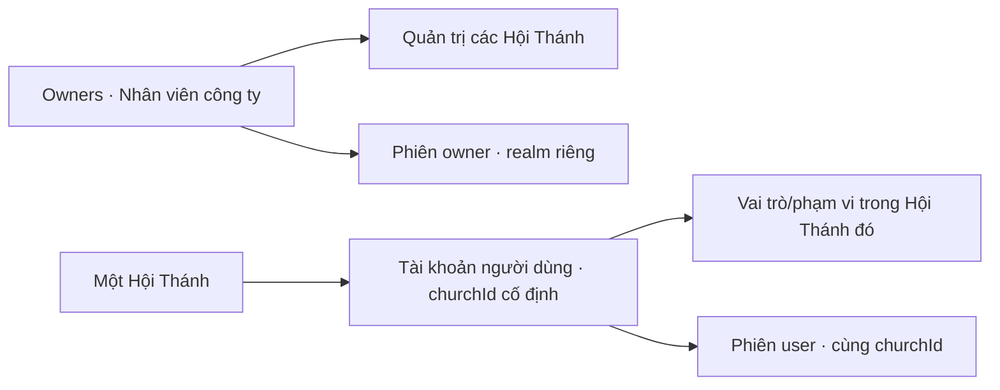

# P0 nền tảng — Mô hình dữ liệu, API và nghiệm thu

Revision: **P0-FOUNDATION-r2** · 2026-11-10 · Task cha `CHURCH-P0`.

**HUMAN ACCEPTED — Khiêm duyệt r2 tại C20 (“Duyệt r2.”).** Thiết kế đã sửa theo C19. Phê duyệt bao gồm model/API/acceptance và các lựa chọn kỹ thuật được trình trong r2; không phải quyền coding, runtime/UAT hoặc phát hành. Chỉ viết tài liệu, chưa implement ứng dụng/database. [r1 lưu nguyên bản](P0-FOUNDATION-r1.md) là lịch sử đã bị thay thế; không dùng mô hình account chung/membership của r1 để coding. Phê duyệt mockup cũ không giữ lại hành vi trái C19.

Nguồn sản phẩm: [CHURCH-P0](../tasks/CHURCH-P0.md). Trạng thái sống: [project-state](../project-state.md). Không có schema/code/runtime để chứng minh thiết kế đã hoạt động.

## 1. Yêu cầu có thẩm quyền và lựa chọn kỹ thuật

**ĐÃ XÁC NHẬN tại C19:** owner là nhân viên của công ty cung cấp dịch vụ QLHT. Tài khoản người dùng thuộc **đúng một Hội Thánh duy nhất**. Tenant cô lập; chỉ tài khoản owner được across tenant. Không có tài khoản người dùng toàn hệ thống hoặc tài khoản tham gia nhiều Hội Thánh.

**GIỮ từ các quyết định trước:** UI gốc/wordless, owner cấp tài khoản và hỗ trợ trực tiếp, mật khẩu mới 8–128 ký tự, mật khẩu tạm24h/đổi lần đầu, idle15m/absolute8h, 2FA ngoài scope. O-D2 tiếp tục áp dụng: owner across tenant không đồng nghĩa mặc định xem finance/dâng hiến cá nhân/cầu thay riêng tư hoặc duyệt chi.

| Mã | Thiết kế r2 | Trạng thái |
|---|---|---|
| FD01 | Modular monolith, MongoDB scoped collections, Redis rate-limit | Đã duyệt C20 |
| FD02 | `accounts` bắt buộc churchId; `owners` tách riêng; không collection memberships | Cụ thể hóa C19, đã duyệt C20 |
| FD03 | MongoDB authoritative sessions/revocation; cookie theo realm | Đã duyệt C20 |
| FD04 | Cùng origin frontend/API, cookie HttpOnly/Secure và CSRF/Origin | Đã duyệt C20 |
| FD05 | User login từ `/h/{churchCode}/login`, vào thẳng tenant cố định; owner từ `/owner/login`, chọn tenant qua O01 | Đã duyệt C20; giữ form A01, không trường chọn tenant mới |
| FD06 | CAS/unique indexes/transaction/fence/idempotency | Đã duyệt C20 |
| FD07 | Secret temp chỉ response đầu, không replay plaintext; đối soát trước cấp lại | Đã duyệt C20 |

Các ngưỡng rate-limit/hash/pagination/token bên dưới vẫn là thông số thiết kế được C20 duyệt, không giả là thông số đã chạy trong prototype. Không invitation, public signup/reset, 2FA, billing hoặc module P2–P7 trong thiết kế này.

## 2. Danh tính, tenancy và UI caller



- Account user không có trường danh sách tenant, không membership và không endpoint gán thêm tenant. churchId bất biến từ lúc tạo.
- Nếu cùng một người cần tài khoản ở Hội Thánh khác, đó là **account riêng**, credentials/session/status riêng; không ghép hoặc đồng bộ. Việc cho trùng email giữa các tenant là đề xuất kỹ thuật (unique churchId+emailKey), không quyền cross-tenant.
- Owner có account nhân viên riêng trong `owners`, không phải user có cờ owner hoặc role Mục sư. Không nâng account user thành owner qua UI/HTTP.
- User không thấy A02 chọn Hội Thánh, không có chức năng đổi tenant hoặc danh bạ tenant. Topbar hiện Hội Thánh cố định, không click để chuyển.
- Owner vào O01/O02, dùng W01–W18 theo quyền O-D1/O-D2, actor luôn là owner thật; không impersonation.
- Tạm ngưng church chặn users của church đó, không khóa/xóa account và không ảnh hưởng account độc lập ở church khác. Khóa/cấp lại user chỉ ảnh hưởng chính account và phiên của church đó.
- Tài khoản nhân viên owner không mặc định có hồ sơ thuộc viên; không ghép danh tính theo tên/email.

### 2.1 Đăng nhập không nhập nhằng

Đề xuất owner bàn giao đúng URL `/h/{churchCode}/login`, email và mật khẩu tạm. Form A01 giữ Email/Mật khẩu/nút/hỗ trợ; không thêm field chọn Hội Thánh. churchCode được lấy từ route, **không coi là authorization**. API resolve church trước khi lookup account bằng churchId+emailKey. Không tự tìm email toàn database rồi chọn tài khoản đầu tiên; không liệt kê các church có email đó.

Đăng nhập owner đi `/owner/login` và endpoint owner riêng. User gửi cùng email/password tới route owner không được kiểm tra như user rồi nâng quyền. Mỗi realm chỉ xác minh principal trong collection của realm đó.

Chưa có domain production hoặc đường dẫn deploy được chốt. Route trên là đề xuất tương đối, không URL truy cập thật. Không public API tra cứu danh bạ Hội Thánh. Sai churchCode/email/password/locked dùng lỗi login chung; chỉ sau xác minh đúng password mới trả lỗi temp hết hạn hoặc church tạm ngưng. Không lộ tên church ở response login thất bại.

Owner có thể dùng hai tab chọn hai church; user không thể đổi church bằng tab/URL. Nếu đăng nhập account user độc lập khác trong cùng browser, cookie user được thay; tab cũ phải re-bootstrap/clear cache khi principal hoặc church không khớp, không giữ dữ liệu account trước. Không hứa nhiều user-account độc lập hoạt động đồng thời trong cùng browser profile.

## 3. Ownership, schema và invariants

Identity sở hữu accounts/owners/credentials/sessions; Tenancy sở hữu churches; Authorization sở hữu role/capability catalogue versioned; Owner service điều phối; Audit/Operations sở hữu journal nghiệp vụ/idempotency. Module gọi public service contracts trong cùng process; không đưa collection handle hoặc passwordHash ra caller khác.

Quy ước: ObjectId API dạng 24 hex; timestamps BSON Date UTC/API ISO8601 UTC; business code bất biến, không dùng làm FK. `version` CAS/ETag riêng với `writeFence` nội bộ. Tên1–160 code points, address<=500, phone string<=32 giữ +/0 đầu. Email ASCII<=254, emailKey trim/lowercase, không xóa dấu chấm/plus alias. nameKey/displayNameKey lowercase tên trim, không bỏ dấu. Password không trim/normalize/truncate.

| Collection | Trường chính | Invariants |
|---|---|---|
| `churches` | id,code,name,nameKey,province,district?,address?,contact?,status active/suspended,version,writeFence,timestamps/actor | code unique tự sinh HT- +10 base32, collision retry hữu hạn; name không unique |
| `accounts` | id,**churchId**,email,emailKey,displayName,displayNameKey,**role,scope**,subjectMemberId?,status active/locked,authEpoch,version,writeFence,timestamps/actor | churchId required/immutable; không platformRole/list tenant; unique churchId+emailKey; role chỉ của Hội Thánh |
| `owners` | id,email,emailKey,displayName,status active/locked,authEpoch,version,writeFence,timestamps | Nhân viên nhà cung cấp; unique emailKey trong owners; không churchId/membership; không endpoint tạo owner từ user |
| `credentials` | id,principalKind church_user/owner,principalId,churchId nullable,passwordHash,kind temporary/permanent,temporaryExpiresAt?,credentialVersion,writeFence,updatedAt | unique principalKind+principalId; user churchId bắt buộc khớp account; owner churchId null. Temp có hạn, permanent không hạn temp |
| `sessions` | id,tokenHash,realm church/owner,principalId?,churchId?,kind bootstrap/password_change/full,authEpoch?,credentialVersion?,csrfTokenHash,csrfKeyVersion,createdAt,lastActivityAt,lastPasswordVerifiedAt?,absoluteExpiresAt,revokedAt?,writeFence | user authenticated churchId required khớp account; owner null; bootstrap không principal/epoch. Không list tenant/quyền đóng băng |
| `audit_events` | id,occurredAt,actorKind owner/church_user/system/anonymous,actorId?,actorChurchId?,**targetChurchId?**,eventType,targetType,targetId?,outcome,changedFields,safeSummary,requestId,operationId? | User actorChurchId=targetChurchId; owner actorChurchId null, target tenant ghi rõ; event nền tảng null không thuộc mọi tenant. Append-only app, không secrets |
| `idempotency_operations` | id,ownerId,method,routeKey,keyHash,payloadHash,status completed,resourceRefs,safeResult,createdAt,expiresAt | routeKey chứa church/account đích; TX atomic với mutation; không plaintext credential |
| `platform_guard` | id owner-registry,activeOwnerCount,version | Guard owner cuối cùng; vận hành riêng, không HTTP tùy ý sửa |

Không foreign-key native được giả định: service xác minh principal/credential/session/scope cùng tenant trong transaction, Mongo validator kiểm tra required/type/enum và các nhánh user/owner/bootstrap. Không cascade delete hoặc endpoint đổi churchId. Không root account dùng chung, không migration thực thi vì chưa có app/data.

### 3.1 Role và scope trong account user

Một account một role: pastor/secretary/treasurer/ministry_lead/member. `church` cho ba role đầu nhưng capability vẫn giới hạn; `assigned_units` cho lead cần1–50 unitIds có thật cùng church; `self` cho member. subjectMemberId chỉ nối qua module thuộc viên xác minh, không auto-match email.

P1 chưa có catalogue tổ chức P2: nếu không có target hợp lệ thì cấp assigned_units trả422 SCOPE_TARGET_NOT_AVAILABLE, không tạo group giả hoặc cho church-wide. Member chưa gắn subject thì không dữ liệu self nghiệp vụ; vẫn đăng nhập đúng church.

Owner across tenant chỉ thông qua owner routes/capabilities rõ ràng. Không role tài chính/private prayer mặc định; không API tự cấp thêm quyền nhạy cảm. Người dùng Hội Thánh không cấp account hay đọc owner audit. Routes chưa có policy deny-by-default.

### 3.2 Index / access patterns

| Mã | Index | Truy vấn/constraint |
|---|---|---|
| IX01 | churches code unique; status+nameKey+id và nameKey+id | O01 list/search keyset |
| IX02 | accounts **churchId+emailKey unique**; churchId+displayNameKey+id; churchId+status+role+id | Lookup login, O03 list scoped; không unique emailKey toàn accounts |
| IX03 | owners emailKey unique | Login nhân viên; không join email user |
| IX04 | credentials principalKind+principalId unique; churchId+principalId | Principal typed lookup, đúng tenant |
| IX05 | sessions tokenHash unique; realm+principalId+churchId; TTL riêng absoluteExpiresAt expireAfterSeconds=0 | Session lookup/revoke/cleanup |
| IX06 | audit targetChurchId+occurredAt DESC+id DESC; occurredAt DESC+id DESC | Audit owner đúng scope/global |
| IX07 | operations ownerId+method+routeKey+keyHash unique; TTL riêng expiresAt | Retry/đối soát/cleanup |
| IX08 | platform_guard id unique mặc định | Owner count guard |

Compound indexes có field order như bảng; không compound TTL. TTL chỉ cleanup, service phải check expiry ngay cả khi record còn. Không TTL accounts/owners/credentials/audit. [MongoDB TTL](https://www.mongodb.com/docs/manual/core/index-ttl/)

Owner search q<=100, exact code/email rồi escaped prefix tên/email hoặc địa bàn; không raw regex/fuzzy/diacritics mới. Scoped account query luôn bắt đầu churchId trước count/filter/pagination. Địa bàn search cần explain/benchmark, chưa hứa có index. Không join user theo email giữa tenant.

KPI: số account active của church; thuộc viên/hộ/ban/khu vực do module P2 cấp qua query contract scoped. P1 chưa có số liệu trả null + availability:not_available, UI dấu —, không số0 giả. Ban và Khu vực là hai số riêng. Counts không leak tenant khác.

## 4. Credential, session và isolation

### 4.1 Hai realm tách biệt

Cookie `__Host-qlht_church_session` và `__Host-qlht_owner_session`, cùng thuộc Secure/HttpOnly/SameSite=Lax/Path=/, không Domain; opaque random256-bit, DB chỉ tokenHash. Bootstrap cookie riêng theo realm, hạn15m; không privileged session. Cookie nào được đọc quyết định bởi route server, **không tự ưu tiên cookie owner khi user route thất bại**. Có cả hai cookie trong browser không làm user request được nâng quyền.

CSRF: GET `/auth/csrf?realm=church|owner` cấp token gắn bootstrap/session đúng realm; POST/PATCH kiểm tra X-CSRF-Token + exact Origin. CSRF dẫn xuất HMAC-SHA256 bằng server key có version + realm+tokenHash+purpose, lưu hash, constant-time compare; GET lại không rotate phá tab khác. Session rotate thì rotate CSRF. Không localStorage bearer, URL token hoặc log body/header secret. Không CORS wildcard credentials; production cùng origin và local HTTPS được cấu hình khi implement. [OWASP CSRF](https://cheatsheetseries.owasp.org/cheatsheets/Cross-Site_Request_Forgery_Prevention_Cheat_Sheet.html)

Full session absolute8h/idle15m; foreground activity throttle30s, polling không touch. Reauth active hoặc idle-expired (chưa absolute/revoked) verify password trong đúng realm, rotate cookie/CSRF, giữ absolute deadline cũ. Epoch mismatch không hồi sinh. Limited password_change hạn min(15m, tempExpiry), chỉ me/csrf/change/logout cùng realm. Activity không cập nhật lastPasswordVerifiedAt. Hết phiên không tự replay mutation. [OWASP session](https://cheatsheetseries.owasp.org/cheatsheets/Session_Management_Cheat_Sheet.html)

Mỗi user request: cookie church → full/epoch/expiry → account active → account.churchId=session.churchId=route.churchId → church active → role/scope. Query/body/cursor khác tenant bị từ chối, không thử lại bằng owner cookie. Owner request: cookie owner → owner active/full → capability → target church tường minh. Admin đọc suspended để mở lại được; business context không ghi tenant suspended.

Mongo unavailable503, không cache quyền để cho qua. Redis unavailable503 cho login/reauth/temp reset không kiểm soát rate được; các route đã xác thực vẫn enforce Mongo nếu không cần Redis. Không dùng selectedChurch server toàn cục.

### 4.2 Password

Giữ8–128 Unicode code points, khác temp, hỗ trợ paste/password manager/khoảng trắng; reject malformed Unicode và >512 byte UTF-8. FE/API cùng cách đếm, không UTF-16 unit. Blocklist cục bộ versioned, không gửi password ra ngoài hoặc hứa bao phủ mọi breach.

Argon2id async Bun.password đề xuất64MiB/3 iterations/parallelism1, benchmark/hash concurrency trước P1 acceptance. Không tự giảm cost để pass latency. Temp20 base32 cryptographic (100-bit), hạn24h, show rõ response đầu, không xem lại; không shared default. [Bun.password](https://bun.sh/reference/bun/password)

Verify/hash ngoài TX, commit CAS credentialVersion/authEpoch/account status để reset đồng thời không bị bỏ qua. Đổi/cấp lại chỉ xoay credential và phiên **của đúng principal/account trong church đó**, không tác động account khác dù cùng email. Account email trùng giữa các church không chia sẻ password/hash. Sau đổi về A01 đúng URL church; owner password flow về owner login. Không có bước 2FA.

Rate limit đề xuất:5 sai/15m theo realm+churchCode(or owner realm)+HMAC(emailKey),20 thử/15m theo realm+IP;429 Retry-After, không permanent lock do sai. Dummy hash cho unknown. Owner reset5/giờ theo church+account; không cùng email gây lock chéo tenant. Tránh gọi bucket user một cách global theo email. Timing/message chung, kể cả code church sai.

## 5. Transaction, retry và owner lifecycle

Yêu cầu Mongo replica set cho transaction tests/production, snapshot reads/majority writes. Dùng transaction có chủ đích; không standalone hoặc giả rollback đa collection. [MongoDB transactions](https://www.mongodb.com/docs/manual/core/transactions/)

Mutation P1 conditional writeFence trên actor/session/principal đích/church; CAS resource version. Status/reset transaction ghi cùng guard doc khiến write-skew phải retry kiểm tra lại quyền. Điểm chấp nhận mutation là commit; read đã authorize có thể kết thúc, không hứa thu hồi byte đã gửi. Fence serializes admin writes, phải đo trước mở rộng nghiệp vụ đông người P3. Tác vụ nền tương lai kiểm tra target scope mỗi batch.

| Mã | Transaction | Kết quả |
|---|---|---|
| TX01 | Church + audit + operation | code unique, không auto account |
| TX02 | Account(churchId,role,scope) + credentials + audit + operation | unique church/email; không reuse account khác tenant |
| TX03 | Sửa role/scope/status account + audit + operation | CAS, authEpoch tăng khi status; không đổi churchId |
| TX04 | Password change/temp reset + audit (+ operation owner reset) | CredentialVersion/authEpoch tăng, revoke phiên account đích; không account cùng email ở nơi khác |
| TX05 | Suspend/resume church + audit + operation | Giữ accounts/dữ liệu, check active tenant cho business |
| TX06 | Login/reauth tạo/rotate session + audit | Check đúng realm/tenant, epoch/version sau verify |

Transient abort retry body hữu hạn<=3 có jitter và đọc lại guard; unknown commit retry commit/đối soát cùng TX, không tự chạy body thành ý định mới. Không external calls trong TX.

Owner mutation POST/PATCH cần Idempotency-Key UUID, scope owner+method+route chứa church/account. Hash validated payload+If-Match; authorize hiện hành rồi replay trước check version cũ. Cùng key/body safe result, khác409; transaction claim+mutation cùng commit. Inflight409 OPERATION_IN_PROGRESS, unknown503 OUTCOME_UNKNOWN, giữ cùng key. Ledger48h, retry client hỗ trợ24h; key quá hạn kiểm tra time dù TTL chưa xóa, quá retry window đối soát trước ý định mới.

Temp secret chỉ response đầu no-store/TLS. Ledger không plaintext; replay200 với temporaryCredential:null, credentialReplay:not_available và resourceRefs/operationId. F22 không bao giờ trả secret. Nếu mất response owner replay đối soát, rồi **chủ động** cấp lại nếu cần, mật khẩu cũ vô hiệu; không tự reset do timeout.

Bootstrap owners là thao tác vận hành riêng cần quyền deploy, không endpoint public/cờ platformRole trong account user. Owner count/status đồng bộ platform_guard, không tự khóa chính mình hoặc owner cuối cùng. Thiết kế cấp/khôi phục nhân viên owner là runbook trước production, không tự mượn account tenant hoặc mở public recovery. Chưa có script/bootstrap/nhân viên thật được tạo.

## 6. API r2

Base `/api/v1`; JSON UTF-8; Date + X-Request-Id, JSON `{data,meta:{requestId}}` hoặc `{error:{code,message,fieldErrors?},meta:{requestId}}`;204 không body. No-store auth/accounts/operations/secrets. Không DTO hash/raw session/CSRF hash/internal fences; error không stacktrace.

PATCH If-Match version bắt buộc428, stale412. Omitted giữ nguyên, null chỉ clear optional allowlist. Không sửa churchId/email/owner privilege qua PATCH. Mutations owner còn CSRF, Origin, Idempotency-Key.

Pagination owner list: default25,max100, cursor HMAC actor+route+church/filterHash+last tuple+hạn15m, không authorization. NameKey/displayNameKey+id ASC, audit time+id DESC; stable tie, không snapshot promise/exact total mặc định. User không có list tenant/cursor across tenant.

### 6.1 Catalogue contracts

`user`=cookie church đúng tenant/full; `owner`=cookie owner/full; `limited`=đổi password đúng realm. Các path auth không có churchId vẫn lấy tenant từ session, không nhận tenant override từ client.

| ID | Method / path | Actor/caller | Input → output thành công |
|---|---|---|---|
| F01 | GET `/auth/csrf` | bootstrap/user/owner | realm query → token/expiresAt200; không tạo authenticated principal |
| F02 | POST `/auth/login` | bootstrap church; A01 | churchCode,email,password → user sessionState/cookie/CSRF200, fixed churchId sau verify |
| F03 | GET `/auth/me` | user/limited church | safe account + churchId/role/scope/sessionState; limited chỉ account basic, không data/context |
| F04 | POST `/auth/logout` | church realm | revoke/clear church cookie204; không logout owner cookie |
| F05 | POST `/auth/change-initial-password` | limited church; A04 | newPassword,confirmation →204 clear cookie, về church login |
| F06 | POST `/auth/reauth` | church full active/idle | password →200 rotate cookie, không đổi tenant/absolute deadline |
| F07 | POST `/auth/activity` | user chưa idle | monotonic touch/throttle204 |
| F09 | GET `/churches/{churchId}/context` | user; W app boot | path phải khớp session/account → safe context/capabilities200 |
| F10 | GET `/owner/churches` | owner; O01 | q,status,limit,cursor → scoped admin list200 |
| F11 | POST `/owner/churches` | owner; O01 | name,province,district?,address?,contact? → ChurchDTO/operation201 |
| F12 | GET `/owner/churches/{churchId}` | owner; O02 | detail/counters200, suspended được |
| F13 | PATCH `/owner/churches/{churchId}` | owner; O02 | info allowlist+If-Match → updated ChurchDTO200 |
| F14 | PATCH `/owner/churches/{churchId}/status` | owner; O02 | status,reason,If-Match →200 |
| F15 | GET `/owner/churches/{churchId}/accounts` | owner; O03 | q,role?,status?,limit,cursor → accounts cùng church200 |
| F16 | GET `/owner/churches/{churchId}/accounts/{accountId}` | owner; O03 | lookup cả churchId+id → AccountDTO200, không account tenant khác |
| F17 | POST `/owner/churches/{churchId}/accounts` | owner; O03 | email,displayName,role,scope → account+operation+temp response đầu201; trùng cùng church409 |
| F18 | PATCH `/owner/churches/{churchId}/accounts/{accountId}/permissions` | owner; O03 | role,scope,If-Match → AccountDTO200; không chuyển account sang tenant khác |
| F19 | PATCH `/owner/churches/{churchId}/accounts/{accountId}/status` | owner; O03 | active/locked,reason,If-Match →200 revoke theo account; không thao tác membership |
| F21 | POST `/owner/churches/{churchId}/accounts/{accountId}/temporary-passwords` | owner; hỗ trợ | supportReference,If-Match account → temp/operation201; warning đúng account/church |
| F22 | GET `/owner/operations/{operationId}` | owner đã tạo | safe result/resourceRefs200, không secret |
| F23 | GET `/owner/audit-events` | owner; backend audit | churchId?,eventType?,from?,to?,limit,cursor → scoped/global owner-safe events200 |
| F24 | GET `/owner/churches/{churchId}/context` | owner; vào quản lý O02 | explicit church/capabilities200, actor owner; business suspended bị chặn |
| F25 | POST `/owner/auth/login` | bootstrap owner | email,password → owner sessionState/cookie/CSRF200; không lookup accounts |
| F26 | GET `/owner/auth/me` | owner/limited owner | safe employee identity/sessionState; không masquerade user |
| F27 | POST `/owner/auth/logout` | owner realm | clear owner cookie/revoke204; không đọc church cookie |
| F28 | POST `/owner/auth/change-initial-password` | limited owner | newPassword,confirmation →204 về owner login |
| F29 | POST `/owner/auth/reauth` | owner full active/idle | password →200 rotate owner cookie, giữ absolute deadline |
| F30 | POST `/owner/auth/activity` | owner chưa idle | touch/throttle204 |

**28 endpoint active.** Giữ IDs traceability; **F08 `/me/churches` và F20 global-account status bị loại bỏ**, không route alias/backward compatibility vì chưa có ứng dụng. F18/F19 chuyển semantics từ membership sang permissions/status của account cố định. F21 bỏ confirmationScope:all_churches. F24–F30 mới tách owner khỏi user realm; không thêm UI menu.

Không owner cookie fallback ở F02–F09; không church cookie ở owner routes. Future business owner/user route cũng tách namespace, dù cùng renderer W. churchId/body override field không allowlist bị422; path không đúng account tenant404. Login realm là route xác định server, không field role do client tự cấp.

F17 email trùng trong cùng church trả409 ACCOUNT_EXISTS với safe ID cho owner mở sửa; email trùng church khác tạo account độc lập, không đọc credential/profile tenant kia, không báo có email ở đâu khác. F18 scope reference module P2 kiểm tra cùng tenant; thiếu target422. F21 chỉ active account, owner recent password auth<=5m (F29), supportReference1–200, không giấy tờ/workflow mới, không reset owner account. Thao tác status/reset đúng church không ảnh hưởng account khác cùng email.

F23 là backend capability, không thiết kế menu audit mới. Event targetChurchId null chỉ owner global query; không biến thành event tất cả tenant. User không có audit across tenant.

### 6.2 DTO mẫu

IDs/password trong ví dụ là placeholder, không credential thực.

```json
{
  "data": {
    "account": {
      "id":"000000000000000000000001",
      "churchId":"000000000000000000000002",
      "email":"an@example.com",
      "displayName":"Nguyễn Văn An",
      "role":"secretary",
      "scope":{"kind":"church"},
      "status":"active",
      "version":1
    },
    "operationId":"000000000000000000000003",
    "temporaryCredential":{"password":"<response đầu, không replay>","expiresAt":"<ISO8601 UTC>"}
  },
  "meta":{"requestId":"<request-id>","replayed":false}
}
```

Owner DTO tách loại `principalKind:owner`, employeeId/email/displayName/platformCapabilities; không role/scope tenant. User DTO không danh sách churches hoặc memberships.

| HTTP / code | Ý nghĩa |
|---|---|
| 400 INVALID_REQUEST / INVALID_CURSOR / CURSOR_CONTEXT_MISMATCH / CURSOR_EXPIRED | JSON/ID/query/cursor sai; không chi tiết nội bộ |
| 401 INVALID_CREDENTIALS | Sai churchCode/email/password/locked hoặc sai owner login: thông báo chung |
| 401 TEMP_PASSWORD_EXPIRED | Chỉ sau verify đúng temp, về card hỗ trợ |
| 401 SESSION_EXPIRED / SESSION_REVOKED / REAUTH_REQUIRED | Về login đúng realm hoặc reauth, không tự replay write |
| 403 PASSWORD_CHANGE_REQUIRED / CSRF_FAILED / FORBIDDEN / RECENT_AUTH_REQUIRED | Limited hoặc thiếu quyền/CSRF/reauth |
| 403 CHURCH_SUSPENDED | Chỉ sau xác minh caller có quyền đúng church, không lộ cho ngoài tenant |
| 404 NOT_FOUND | Tài nguyên ngoài tenant/quyền và không tồn tại có response giống nhau |
| 409 ACCOUNT_EXISTS / IDEMPOTENCY_CONFLICT / IDEMPOTENCY_EXPIRED / OPERATION_IN_PROGRESS / LAST_OWNER_PROTECTED | Đối soát hoặc xem lại, không bỏ guard |
| 412 VERSION_CONFLICT / 428 PRECONDITION_REQUIRED | Reload và xem lại thay đổi, không tự overwrite |
| 422 VALIDATION_FAILED / SCOPE_TARGET_NOT_AVAILABLE | Field errors, giữ form, không echo password |
| 429 RATE_LIMITED / 503 DEPENDENCY_UNAVAILABLE / OUTCOME_UNKNOWN | Retry-After hoặc đối soát; không fallback quyền |

## 7. Audit và vận hành

Events: church.created/updated/status_changed, account.created/permissions_changed/status_changed/temp_password_issued/password_changed, owner.bootstrap/status_changed/password_changed, auth.login_succeeded/failed/reauth/logout, authorization.denied. Không membership.granted. Ghi đúng principalKind/actorId/targetChurchId, không giả actor của user được hỗ trợ.

Mutation thành công audit cùng TX, abort không success audit. Failed/denied safe event riêng. Không raw email/password/hash/token/cookie/body secret trong public logs; requestId/route template/status/latency/actor/church đủ cho chẩn đoán. Retention/backup/DB admin chưa xác định, không coi app append-only là chống sửa ở hạ tầng.

Readiness Mongo/Redis/indexes/transaction, liveness không secrets; production cần hạ tầng/TLS/backup/RPO-RTO/workload/runbook owner và quyền deploy riêng. Không tạo dịch vụ/migration/script trong P0. Dữ liệu cùng Mongo không phải cách ly vật lý; tenant isolation là rule/index/query/authorization cần kiểm chứng, không tuyên bố chỉ có churchId đã đủ an toàn.

## 8. Tiêu chí nghiệm thu r2

**Toàn bộ runtime criteria hiện NOT_RUN.** Test thật với Mongo replica set/Redis synthetic, không toàn mocks. Những tiêu chí r1 dùng nhiều tenant/account bị thay thế như bảng này.

| ID | Contracts | Kịch bản / kết quả cần quan sát | Bằng chứng |
|---|---|---|---|
| AC01 | F10–F14/TX01/IX01 | CRUD info/suspend/resume, mã unique, CAS, không tự tạo user | DB integration/UI |
| AC02 | F15–F19/TX02–03/IX02 | Account bắt buộc một churchId; trùng email cùng church409; khác church là account/credential riêng, không reuse | DB concurrency/contract |
| AC03 | F11/F13/F14/F17–F19/F21/F22 | Idempotency cùng key không side effect trùng, payload khác409, mất response đối soát | Fault/concurrency |
| AC04 | F17/F21/F22 | Temp response đầu, không replay/log/plaintext persistence; reset chủ động đúng church/account | Contract/log/UI |
| AC05 | F02–F05/F25–F28 | Temp→limited đúng realm, không data/context/owner bypass, không skip | Contract/E2E |
| AC06 | F05/F28 |7 reject,8/128 pass nếu điều kiện khác đạt,129 reject; Unicode/whitespace/paste nhất quán | Validator/browser/API |
| AC07 | F05/F21/F28/TX04 | Temp24h, reissue/đổi invalidold/session, hai tab chỉ một thắng; account cùng email khác tenant không bị ảnh hưởng | Clock/concurrency |
| AC08 | F02/F05/F25/F28 | Đổi password→login đúng realm, email điền sẵn, temp cũ fail; mất response thử password mới | E2E |
| AC09 | F03/F09/F16/F24 | User churchId cố định, URL/body/cursor sang B không lộ data/count/name; chỉ owner vào các church được phép | Negative contract |
| AC10 | F09/F24/F03/F26 | User không A02/chuyển tenant; owner hai tab hai target không lẫn; có cả hai cookie vẫn không nâng user request | Browser/HTTP |
| AC11 | F14/F19/TX05 | Suspend church chặn users church đó, khóa account không ảnh hưởng account độc lập khác; unlock không revive phiên | Multi-tenant integration |
| AC12 | F18/F19/fences | Role/status đổi khi request ghi: commit theo guard mới, không quyền cũ sau thu hồi | Barrier concurrency |
| AC13 | F09/F24/policy | Owner across tenant không mặc định finance/private; user scope tự gắn, không platformRole/owner escalation | Policy/negative tests |
| AC14 | F06/F07/F29/F30 | Idle15m/absolute8h/limited15m, polling không touch, reauth không kéo absolute; epoch revoked không revive | Clock integration |
| AC15 | F01–F07/F25–F30 | CSRF/Origin/cookie đúng realm, token fixation/ambient owner cookie không bypass, logout chỉ realm của mình | Browser/security |
| AC16 | F02/F06/F21/F25/F29 | Rate-limit scoped tenant+realm/email, không ảnh hưởng email ở church khác; IP limiter/failure503 không bypass | Redis/fault |
| AC17 | TX01–06/IX05/IX07 | Fail TX không half account/credentials/audit; TTL chưa cleanup expired vẫn fail; unknown commit không new intent | Replica set faults |
| AC18 | F15–F19/F21/IX02 | Account A không đọc/sửa/reset bằng route B; không sửa churchId; scope refs cùng tenant; không membership route | Contract/DB |
| AC19 | F10/F15/F23 | Stable keyset/filter/limit/cursor actor+tenant, no exactcount ngầm, scope trước pagination | Dataset/explain |
| AC20 | Owners/platform_guard/F25–F30 | User credentials không login owner; không user flag nâng owner; bootstrap không public; guard owner cuối trong ops | Auth/route/schema |
| AC21 | F21/F29 | Support recent owner auth, supportReference, warning đúng account/church; không all_churches/invitation/2FA | E2E/contract |
| AC22 | F16/F22/F23/audit | DTO không secret, user actorChurchId=target, owner actor giữ thật, target scope chính xác; no unauthorized global audit | Schema/contract/log |
| AC23 | F10/F12/counts | Account count theo active accounts church đó, no membership; P2 chưa có trảnull/— | Contract/render |
| AC24 | A01/A04/O01–O03 | UI gốc/wordless, user URL login không thêm selector; topbar user không chuyển tenant; owner O01 giữ | Render/human |
| AC25 | F08/F20 retired / scope | Không me/churches, membership hoặc user toàn hệ thống, signup/reset/2FA/billing endpoints;28 active routes | Route/schema inventory |
| AC26 | Queries/ops | Explain F10/F15/F23; benchmark dataset/latency/hash-memory ghi rõ; restore/runbook trước production | Measurements/ops |

Chưa có workload thật/ngưỡng performance production nên không bịa capacity. Kế hoạch P1 phải định nghĩa dataset/concurrency/latency/memory và commands lint/typecheck/build/tests thực tế. Source complete ≠ behavior verified ≠ human accepted ≠ released.

## 9. Khác r1 và điểm dừng

| Thành phần r1 | r2 hiện hành |
|---|---|
| Account toàn hệ thống + memberships nhiều church | accounts một churchId cố định + owners riêng; bỏ memberships |
| Global email unique và thêm church cho account có sẵn | unique churchId+emailKey; không gán thêm church; same-email khác church là credential độc lập |
| A02/danh sách/chuyển tenant cho user | Bỏ; user vào đúng tenant, chỉ owner chọn target qua O01 |
| F08 me/churches, F20 global status | Retired, không compatibility alias |
| Membership role/status, reset all_churches | Permissions/status/reset của account trong route church cụ thể |
| Session account chung, owner flag/cookie fallback | Principal typed, cookie/route owner tách user, user session cố định church |

C19 sửa yêu cầu đã xác nhận; route login tenant-specific và policy email trùng là wiring r2 đã được C20 duyệt, không đổi form UI tùy tiện. Không làm migration vì chưa có database/ứng dụng. Giữ nguyên r1 và journal cũ làm lịch sử, ghi handoff r2 riêng; không sửa ngược acceptance/verification cũ thành PASS r2.

Bước sau: r2 đã được Khiêm duyệt tại C20; dừng chờ cho phép lập gói P1, chưa tự coding hoặc mở gói P1. Nghiệp vụ P2–P7 và quyền nhạy cảm của owner vẫn theo hồ sơ P0 và phê duyệt riêng.

## 10. Xác nhận C20

Khiêm: “Duyệt r2.” Phần thiết kế nền tảng r2 HUMAN ACCEPTED; các chữ “đề xuất” trong nội dung mô tả lựa chọn thiết kế đã trình và được chấp thuận, không runtime evidence. [Xác nhận journal](skill-usage/records/CHURCH-P0/foundation-r2-human-acceptance-1.json). Không cấp quyền implement ứng dụng hoặc tự mở gói tiếp.
